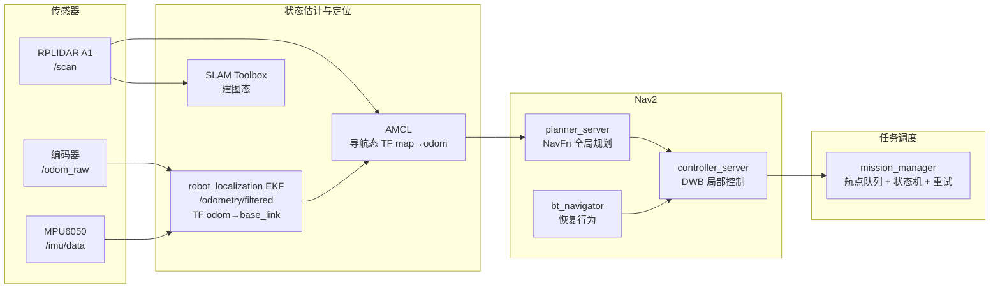

# 基于 Nav2 的室内多点任务导航系统

nav2_mission_nav：SLAM Toolbox 建图 → EKF + AMCL 分层定位 → Nav2 规划避障 → 自研 Mission Manager 多点任务调度。

> 依赖项目一 [`ros2_diff_drive`](../项目一具体方案.md) 的底盘接口（`/cmd_vel`、`/odom_raw`、`/imu/data`、`/odometry/filtered`、TF）。

---

## 系统架构

### 总体架构



### TF 树（每段只允许一个发布者）

```
map ──(AMCL 导航态 / SLAM Toolbox 建图态)──► odom ──(EKF，50Hz 连续)──► base_link
                                              ├──(static)──► laser_frame
                                              ├──(static)──► imu_link
                                              └──(static)──► camera_link   # 项目三预留
```

三条铁律：

1. `map → odom`：导航态只有 AMCL 发，建图态只有 SLAM Toolbox 发，**二选一，不许双发**；
2. `odom → base_link`：只有 EKF 发（项目一 `base_driver` 设 `publish_odom_tf: false`）；
3. 任何断链 / 双发的表象都是"定位跳变""costmap 空白"，第一步永远是
   `ros2 run tf2_tools view_frames` + `ros2 run tf2_ros tf2_echo map odom`。

### 两种运行态

| 运行态 | 启动入口 | `map→odom` 发布者 | 用途 |
|--------|----------|-------------------|------|
| 建图态 | `slam.launch.py` | SLAM Toolbox | 遥控建图，保存 pgm/yaml |
| 导航态 | `mission.launch.py` | AMCL | 加载地图 + 多点任务巡航 |

---

## 仓库结构

```
nav2_mission_nav/
├── README.md                 # 本说明书
├── docs/
│   ├── tuning_notes.md       # 参数调优笔记（改动前后对比）
│   ├── troubleshooting.md    # 踩坑记录（现象→排查→根因→处理）
│   └── field_test_log.md     # 20 轮巡航 / 误差 / IMU 对比原始记录
├── maps/                     # 实测地图（pgm / yaml）
├── scripts/
│   ├── run_patrol_20x.sh     # 20 轮巡航验收，结果自动追加到场测日志
│   ├── measure_pose_error.py # 到点误差统计（均值 / P95）
│   ├── plot_nav_metrics.py   # 从 rosbag 提取路径长度/耗时/重规划并出图
│   └── pose_samples.example.csv
└── src/
    ├── mission_msgs/         # 接口定义（msg + srv）
    ├── mission_manager/      # ★ 自研调度器（C++17）
    │   ├── include/mission_manager/
    │   │   ├── mission_state_machine.hpp   # 纯逻辑状态机（无 ROS 依赖，可单测）
    │   │   ├── waypoint.hpp                # 航点 / 任务数据结构
    │   │   └── mission_manager_node.hpp
    │   └── src/
    │       ├── mission_state_machine.cpp   # 状态转移表
    │       ├── waypoint_loader.cpp         # YAML 解析
    │       └── mission_manager_node.cpp    # ROS I/O + Tick 主循环
    └── mission_bringup/      # launch + config 总入口
        ├── launch/
        │   ├── bringup.launch.py   # 底盘 + 雷达 + 静态 TF
        │   ├── slam.launch.py      # 建图
        │   ├── nav.launch.py       # 导航全栈（map_server + AMCL + Nav2）
        │   └── mission.launch.py   # 导航 + mission_manager（一键演示）
        └── config/
            ├── nav2_params.yaml    # Nav2 主参数（主战场）
            ├── slam_toolbox.yaml   # 建图参数
            ├── bt/navigate_to_pose_recovery.xml  # 裁剪版恢复行为树
            └── waypoints/          # 航点任务示例
                ├── five_points.yaml
                └── lab_patrol.yaml
```

---

##  接口定义

### `MissionStatus.msg` —— 任务状态机对外快照

```yaml
std_msgs/Header header
uint8 state              # 状态机枚举，见 §6.2
uint8 current_index      # 当前航点序号
uint8 total_waypoints
string mission_name
string current_wp_id
uint8 retry_count        # 当前航点已重试次数
float32 progress         # 0~1 = 已完成航点数 / 总数
string last_error
builtin_interfaces/Duration eta_hint   # 预计剩余时间（预留，当前恒 0）
```

`state` 枚举与 `mission_manager::State` 一一对应：
`STATE_LOADING=0, IDLE=1, NAVIGATING=2, ARRIVED=3, DO_ACTION=4, RETRYING=5, SKIPPED=6, PAUSED=7, DONE=8, FAILED=9, ABORTED=10`。

### `MissionCommand.srv` —— 任务控制命令

```
# 请求
string command        # START | PAUSE | RESUME | ABORT | RELOAD
string mission_file   # RELOAD / START 时可指定路点文件；空则用 launch 默认值
---
# 响应
bool success
string message        # 失败原因
```

| 命令 | 语义 | 典型用法 |
|------|------|----------|
| `START` | 加载（若给了新文件）→ 从当前/断点航点开始巡航 | 启动任务 |
| `PAUSE` | 取消在飞的 NavigateToPose，保留进度 | 临时让路 / 排障 |
| `RESUME` | 重新向当前航点发目标 | 继续任务 |
| `ABORT` | 终止任务并取消目标 | 放弃 / 急停前 |
| `RELOAD` | 重新加载路点文件，回到 IDLE | 换任务 / 终态后重启 |

### 对外话题 / 服务 / Action

| 名称 | 类型 | 方向 | 说明 |
|------|------|------|------|
| `/mission_status` | `mission_msgs/MissionStatus` | 发布 | 状态机快照（tick 驱动，约 5 Hz） |
| `/mission_progress` | `std_msgs/Float32` | 发布 | 0~1 进度，给 Web/仪表用 |
| `/mission_waypoints_vis` | `visualization_msgs/MarkerArray` | 发布 | RViz 航点箭头 + 编号 |
| `/mission_command` | `mission_msgs/srv/MissionCommand` | 服务 | 上表 5 条命令 |
| `/navigate_to_pose` | `nav2_msgs/action/NavigateToPose` | Action Client | 调 Nav2 bt_navigator |

---

## 快速开始

```bash
sudo apt install -y ros-jazzy-navigation2 ros-jazzy-nav2-bringup \
  ros-jazzy-slam-toolbox ros-jazzy-robot-localization ros-jazzy-rplidar-ros

cd ~/ws && colcon build --packages-select mission_msgs mission_manager mission_bringup
source install/setup.bash

# 1) 建图
ros2 launch mission_bringup slam.launch.py
ros2 run teleop_twist_keyboard teleop_twist_keyboard
ros2 run nav2_map_server map_saver_cli -f maps/lab_5x5

# 2) 多点任务巡航
ros2 launch mission_bringup mission.launch.py \
  map:=$(pwd)/maps/lab_5x5.yaml \
  mission:=$(ros2 pkg prefix mission_bringup)/share/mission_bringup/config/waypoints/five_points.yaml

# 3) 任务控制
ros2 service call /mission_command mission_msgs/srv/MissionCommand "{command: 'START', mission_file: ''}"
ros2 topic echo /mission_status
```

## 双机运行（树莓派 + 笔记本）

机器人端（树莓派）**无头运行**，所有 launch 默认 `use_rviz:=false` 不起 RViz；笔记本只起 RViz 看可视化。

```bash
# ---- 树莓派（机器人端）----
export ROS_DOMAIN_ID=42          # 两机必须一致
ros2 launch mission_bringup slam.launch.py      # 或 mission.launch.py

# ---- 笔记本（可视化端）----
export ROS_DOMAIN_ID=42
ros2 launch mission_bringup rviz.launch.py      # 只起 RViz，读 config/rviz/nav.rviz
```
